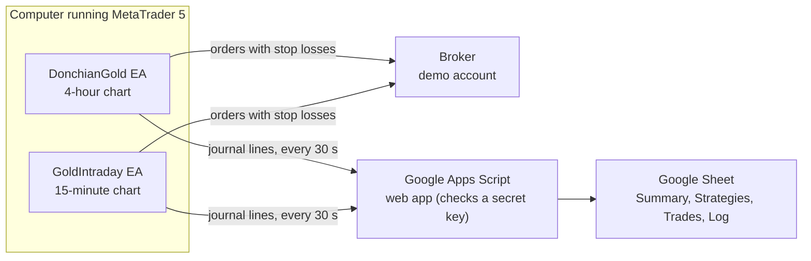
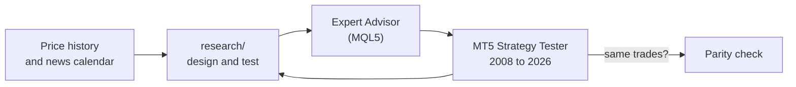

# Donchian Analyst

**An automated gold-trading research project.** Trading rules for gold (XAUUSD) are designed and
tested on 18 years of price history, then run by two MetaTrader 5 robots ("Expert Advisors") on a
**demo account**. Every decision they make is written to a journal and copied into a Google Sheet,
so the live results can be checked against the backtests.

> **Not financial advice. Research and demo trading only.**
> Nothing here recommends buying or selling anything. Backtests are not live results, and past
> results do not predict future ones. Both Expert Advisors refuse to run on a real-money account.
> If you change that, the risk is entirely yours.

---

## Contents

1. [The idea in one minute](#the-idea-in-one-minute)
2. [How the pieces fit together](#how-the-pieces-fit-together)
3. [The strategies](#the-strategies)
4. [How it was tested](#how-it-was-tested)
5. [Results over 18 years](#results-over-18-years)
6. [What was tried and dropped](#what-was-tried-and-dropped)
7. [Safety rules](#safety-rules)
8. [What's in this repository](#whats-in-this-repository)
9. [Running it yourself](#running-it-yourself)
10. [Words used here](#words-used-here)

---

## The idea in one minute

- **One market:** gold against the US dollar, traded as a CFD in MetaTrader 5.
- **Rules, not opinions:** every entry, stop and exit is a fixed rule written in code. Nobody
  touches the trades.
- **Small, fixed risk:** each trade risks a set slice of the account (0.125% to 1%) between its
  entry and its stop loss, and the stop sits at the broker from the moment the trade opens.
- **Two robots:**
  - **DonchianGold** trades big trends on the 4-hour chart and holds for days.
  - **GoldIntraday** runs six short-term strategies on the 15-minute chart, and every trade is
    closed by the end of the day.
- **Proof before money:** every rule is tested on years it was never designed on and over 18 years
  of history before it trades, and even then only on a demo account.

## How the pieces fit together



1. Each robot reads gold's price, applies its rules and sends orders, each with its stop loss, to
   the broker.
2. Every decision (order, entry, exit, skip, warning) goes into a journal file in MetaTrader.
3. Every 30 seconds the robots send any new journal lines to a small Google Apps Script web app.
   It accepts them only with the right secret key.
4. The web app builds a readable results book in Google Sheets: account summary, every trade
   with its result in money and in R, a card for each strategy, and the raw log.

And this is how a rule gets there in the first place:



The research code and the robot are written separately, in two languages. Both are run over the
same history, and their trades are compared one by one ("parity"). The H4 robot matches its
research 97.8% of the time and the intraday robot 96.6%. The few differences come from small
fill-price and holiday-session details.

## The strategies

Times are **broker time**, which is New York time + 7 hours all year. For example, 16:30 broker
is 9:30 in New York, when the US stock market opens.

| Strategy | Chart | When (broker time) | The idea in plain words | Risk a trade |
|---|---|---|---|---|
| **H4 swing breakout** | 4-hour | Any time; holds for days | Gold trends. A 4-hour close at a new 20-bar high, above the 100-bar average, often starts a move that lasts days. Sells are the mirror image. | 1% |
| **New York opening range** | 15-min | Range 16:30–17:00, trades until 20:00 | The first half hour of New York trading often sets the direction for the session. Trade the breakout of that range, in the 4-hour trend's direction only. | 0.125% |
| **Asian range breakout** | 15-min | Range 01:00–09:00, trades 09:00–15:00 | After an unusually quiet Asian night, Europe's open often breaks out hard. Only on narrow nights (Toby Crabel's rule). | 0.25% |
| **Dual Thrust** | 15-min | 01:00–20:00 | A move of half the recent 4-day range away from the open is a real breakout. If stopped, it turns around and trades the other way (Michael Chalek). | 0.25% |
| **R-Breaker** | 15-min | Every 15 min until 20:00 | Levels from yesterday's high, low and close: follow strong breakouts, and catch moves that fail at the day's extremes. In the 4-hour trend's direction. | 0.25% |
| **Momentum at 16:00** | 15-min | One decision at 16:00 | The way gold has moved since the open tends to carry on into the US afternoon (Gao, Han, Li & Zhou, 2018). In the 4-hour trend's direction. | 0.125% |
| **Momentum at 20:00** | 15-min | One decision at 20:00 | The same momentum idea, later in the day. | 0.25% |

All six intraday strategies close their trades by **23:00 broker time** (16:00 New York), before
the daily rollover. The exact entry, stop and exit rules are in [`docs/DESIGN.md`](docs/DESIGN.md)
and at the top of each Expert Advisor.

## How it was tested

1. **Designed on one period, checked on another.** The intraday line-up was chosen on 2023–2024
   data and then checked on 2025–2026, which it had not seen.
2. **Checked on 18 years.** Both robots were run in the MetaTrader 5 Strategy Tester over three
   very different periods:
   - **2008–2014:** the financial crisis, gold's rally to its 2011 peak, then a bear market.
   - **2015–2022:** quiet, mostly sideways years.
   - **2023–2026:** a strong bull market.
3. **Real costs.** The tester charges the broker's spread, and swap on trades held overnight.
4. **Parity.** Each robot's trades are compared one by one with its research version (see above).
5. **Live demo.** Both robots have been trading a demo account since October 2026. The journal
   records the real fill of every order, to measure how much worse real fills are than the
   tester's.

One honest caveat: the tester fills stop orders at exactly their price, so its results are a bit
better than real life.

## Results over 18 years

Results are in **R**: one R is what a trade risks between its entry and its stop. +0.05 R a
trade means it made, on average, 5% of what it risked.

| Strategy | Trades | Average R a trade | 2008–14 | 2015–22 | 2023–26 |
|---|---:|---:|---:|---:|---:|
| H4 swing breakout | 765 | +0.185 | +55.1 R | +43.4 R | +42.9 R |
| New York opening range | 3,186 | +0.044 | +118.1 R | −38.2 R | +60.8 R |
| Asian range breakout | 1,797 | +0.040 | +16.1 R | +36.8 R | +19.8 R |
| Dual Thrust | 1,823 | +0.051 | +64.9 R | +13.8 R | +14.2 R |
| R-Breaker | 907 | +0.059 | +39.0 R | +0.7 R | +13.5 R |
| Momentum at 16:00 | 2,651 | +0.027 | +47.3 R | −17.2 R | +41.9 R |
| Momentum at 20:00 | 2,842 | +0.015 | +18.5 R | +5.1 R | +18.2 R |

The intraday robot as a whole, at today's risk levels, starting from 10,000 in each period:

| Period | Growth | Worst drawdown |
|---|---:|---:|
| 2008–2014 | +66.9% | 10.7% |
| 2015–2022 | +2.8% | 17.7% |
| 2023–2026 | +31.2% | 6.7% |

What these numbers mean:

- **The H4 swing breakout made money in every period.** It is the most dependable part.
- **New York opening range and Momentum at 16:00 depend on the market.** They earn well in lively
  years and lose in quiet ones, so they now trade at half risk (0.125%). That choice was made after
  seeing these results, which flatters the combined figures a little.
- **The edge per trade is small.** Most intraday strategies make a few hundredths of an R a trade.
  It only shows over hundreds of trades, and any few weeks can be negative.

## What was tried and dropped

These ideas were tested and did not hold up, so they are not used. Their research scripts are
kept in `research/`.

| Idea | What happened |
|---|---|
| The 4-hour breakout rules on 15-minute and 1-hour charts, closed each day | No edge: the breakout edge needs trades held overnight. |
| Mean-reversion strategies (fading moves) | Lost money after costs. |
| Avoiding big US news (jobs report, CPI, Fed decisions) | Made results slightly worse. Many of the best breakouts start with news, and closing trades before news cut profits sharply. |
| A machine-learning filter (LightGBM) to skip weak setups | Helped in the quiet years but threw away winners in the bull market. It failed the test it was given in advance. |
| Microsoft's Qlib platform | Built for ranking many stocks against each other, buy-only, with no link to MetaTrader. Not a fit for timing one market. |

## Safety rules

Both robots enforce these in code:

- **Demo account only.** They refuse to run on a real-money account.
- **Gold only.** They refuse any other chart.
- **Every order has its stop loss at the broker** from the moment it opens.
- **One position per strategy.** No adding to losing trades, no martingale, no doubling up.
- **Fixed risk per trade** as in the table above.
- **Intraday trades close by 23:00 broker time**, so they pay no overnight swap.
- **Daily loss limit:** no new intraday trades after the account falls 2% in one day.
- **Emergency stop:** in MetaTrader press F3, then add a global variable `DG_KILL` with value 1.
  Both robots close everything and stop trading.

## What's in this repository

| Path | What it is |
|---|---|
| [`mt5/DonchianGold.mq5`](mt5/DonchianGold.mq5) | The H4 swing breakout robot |
| [`mt5/GoldIntraday.mq5`](mt5/GoldIntraday.mq5) | The six intraday strategies robot |
| [`mt5/SheetSync.mqh`](mt5/SheetSync.mqh) | Shared by both robots: sends journal lines to the Google Sheet |
| [`mt5/ExportCalendar.mq5`](mt5/ExportCalendar.mq5) | Script that exports MetaTrader's economic calendar for the news research |
| [`Mt5.js`](Mt5.js), [`Webhook.js`](Webhook.js) | Apps Script: receives the journals and builds the Sheet's results book |
| Other `*.js` / `*.html` files | The project's original Apps Script system: a backtester, paper trading, a research lab and a Claude-powered analyst. It came first, on Bitcoin, and is now switched off; the code is kept. |
| [`research/`](research/) | Strategy research, parity checks, 18-year tester analysis, the news study and the machine-learning study (Node.js and Python) |
| [`tests/`](tests/) | Offline tests for the Apps Script code |
| [`docs/DESIGN.md`](docs/DESIGN.md) | Why the system works the way it does, with the exact rules and numbers |
| [`docs/OPERATIONS.md`](docs/OPERATIONS.md) | Sheets, settings, menu and deployment details |
| [`donchian_analyst.pine`](donchian_analyst.pine) | The original 4-hour rules for TradingView |

## Running it yourself

**Just reading?** Start with this page, then [`docs/DESIGN.md`](docs/DESIGN.md), then the robots in
[`mt5/`](mt5/).

**Run the tests** (needs [Node.js](https://nodejs.org) 18 or newer):

```bash
node tests/run.js
```

**Run the robots on a demo account:**

1. Open a **demo** account with a broker that offers MetaTrader 5 and gold.
2. Copy the files from `mt5/` into your MetaTrader data folder under `MQL5/Experts/DonchianAnalyst/`
   (File → Open Data Folder), and compile them in MetaEditor.
3. Attach `DonchianGold` to a gold **H4** chart and `GoldIntraday` to a gold **M15** chart, and
   switch on Algo Trading.
4. The robots only accept gold symbols starting with `XAU`; they were built and tested on
   `XAUUSD.sml`. Other brokers' server clocks may differ, which shifts the session times above.
5. The Google Sheet link is optional. Leave the Sheet inputs empty and the robots still trade and
   keep their journals in MetaTrader.

**Run the research:** the scripts read price history you export yourself from MetaTrader into a
`data/` folder, which is not included. Each script explains what it needs at the top.

**Keys and secrets** (the Anthropic API key, the Sheet's shared key and so on) go in Apps Script's
**Script Properties**, never in code.

## Words used here

| Word | Meaning |
|---|---|
| **Expert Advisor (EA)** | A trading robot that runs inside MetaTrader 5 |
| **Demo account** | A practice account with virtual money and real prices |
| **R** | The amount a trade risks between its entry and its stop. Results are counted in R so different trade sizes compare fairly |
| **Drawdown** | The largest drop from a high point of the account to a later low |
| **ATR** | Average True Range: how far gold typically moves in a day or bar. Stops are set as multiples of it |
| **Donchian channel** | The highest high and lowest low of the last N bars. A close outside it is a breakout |
| **EMA** | Exponential moving average, used here as the trend filter |
| **Stop order** | An order that waits at a price and fills only if the market reaches it |
| **Broker time** | The MetaTrader server's clock, New York time + 7 hours |
| **Strategy Tester** | MetaTrader's tool for replaying a robot over past prices |
| **Parity** | The robot and its research version making the same trades on the same history |

## Licence

No licence is granted. You may read the code here, but all other rights are reserved.
